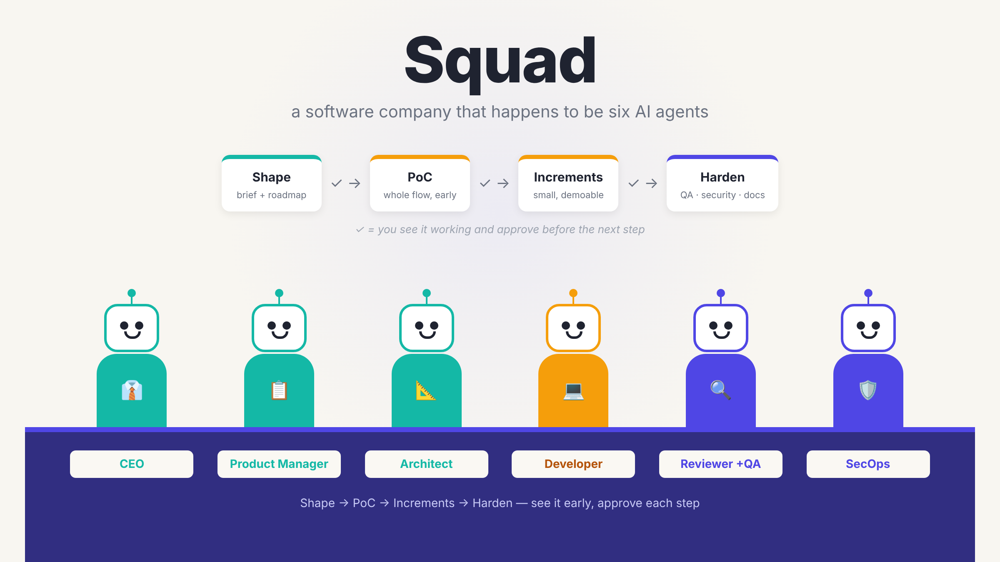
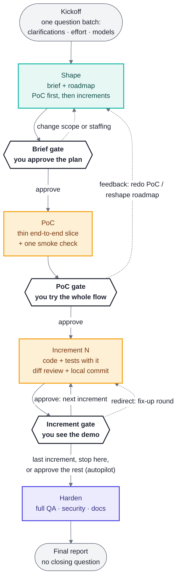
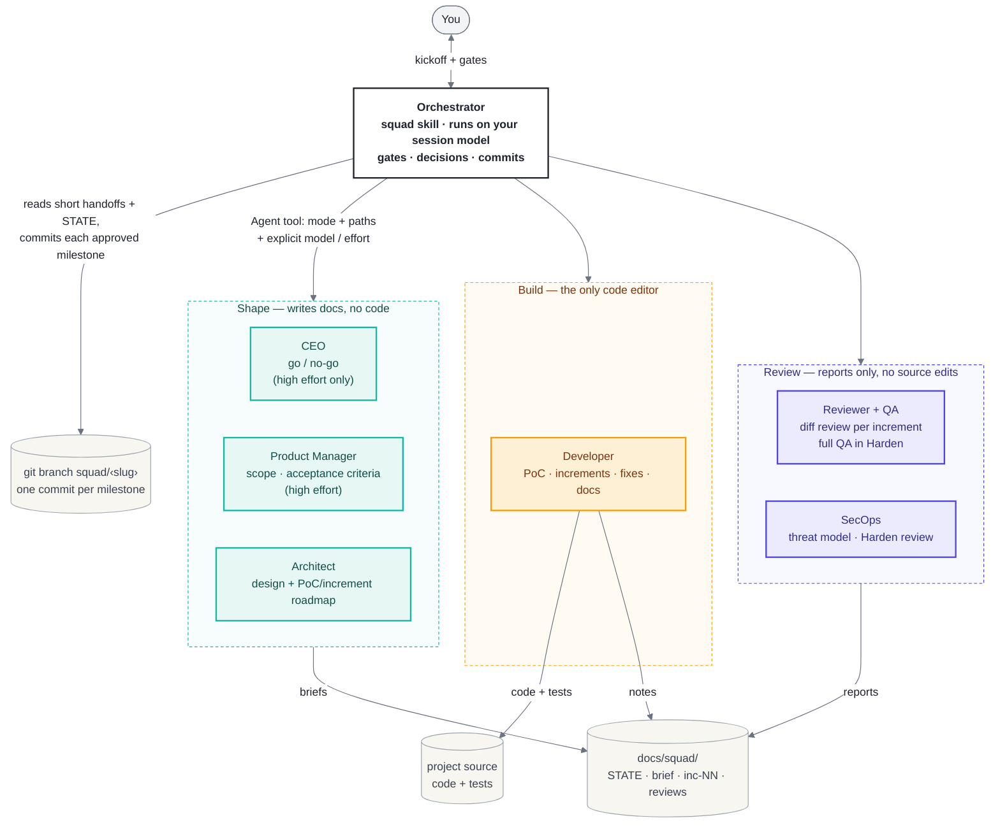
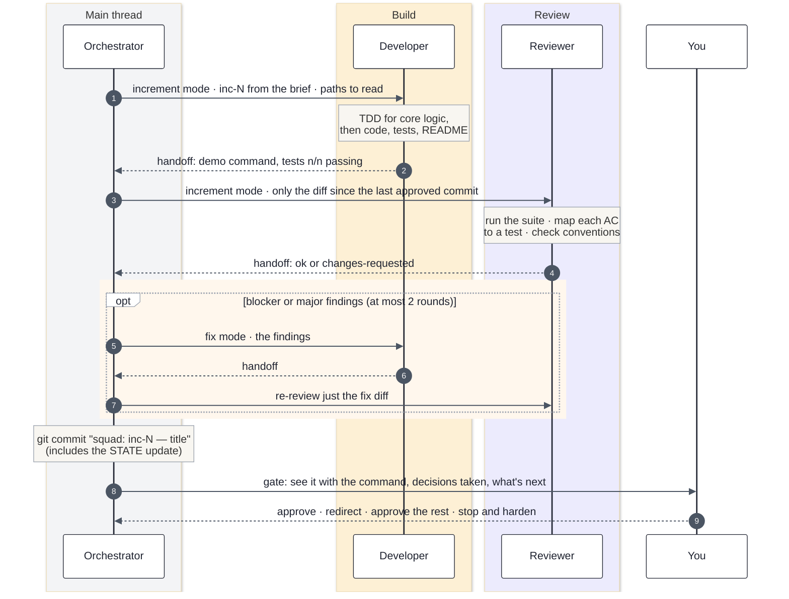
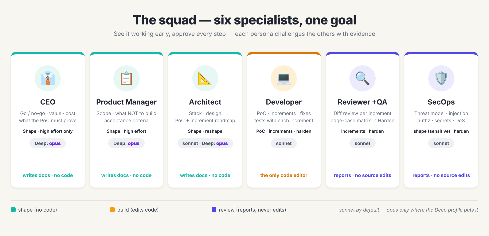

# Squad Skill

Runs an **incremental** software development lifecycle — **Shape → PoC → Increments → Harden** — as
a small, opinionated software company. The skill is the **orchestrator**; the real work is done by
six persona **subagents** it delegates to.



## What it does

You describe what you want built. Squad asks **one batch of questions** up front (clarifications,
effort, model profile), then:

1. **Shape** — writes a short brief: scope, architecture, and a **roadmap** that starts with a
   proof of concept and continues in small increments. *You approve it.*
2. **PoC** — builds the thinnest version that runs **end to end through every layer**, so you can
   try the whole flow and steer before anything is built out. *You give feedback or approve.*
3. **Increments** — builds the rest layer by layer. Each increment is tested, reviewed (only its
   own diff), committed locally, and shown to you with a demo command. *You approve, redirect,
   or say "approve the rest" to let it finish on its own.*
4. **Harden** — full QA (edge cases, end-to-end tests, coverage), a security review, and final docs.
5. **Final report** — what was built, how to run it, results, decisions taken. No closing question.

Between those gates it never stops to ask — it decides, logs the decision, and shows it to you at
the next gate. It interrupts only for a hard stop (missing credentials, an irreversible action the
brief didn't cover, a security blocker with no in-scope fix).



## Effort and model profiles

**Effort** decides how much gets built and how heavy the process is. Each effort comes with a
default **model profile**; you can pick another, or override single personas, at kickoff or at the
Brief gate.

| Effort | Shape | PoC | Increments | Harden | Default profile |
|---|---|---|---|---|---|
| **low** | Orchestrator writes a short brief | The PoC **is** the product | Only for PoC feedback | None (smoke check) | Fast |
| **medium** *(default)* | One Architect call: scope + design + roadmap | Thin slice + smoke check | 1–3, diff-reviewed | Reviewer QA on critical paths; SecOps if sensitive | Balanced |
| **high** | CEO → PM → Architect (+ threat model if sensitive) | Thin slice + smoke check | 2–5, diff-reviewed | Reviewer + SecOps in parallel, ADRs, full docs | Deep |

| Persona | Fast | Balanced *(default)* | Deep |
|---|---|---|---|
| CEO | — | — | `opus` / `medium` |
| Product Manager | — | — | `opus` / `high` |
| Architect | — | `sonnet` / `high` | `opus` / `high` |
| Developer | `sonnet` / `low` | `sonnet` / `medium` | `sonnet` / `high` |
| Reviewer | — | `sonnet` / `medium` | `sonnet` / `high` |
| SecOps | — | `sonnet` / `medium` | `sonnet` / `high` |

**Why sonnet by default:** in a measured medium-effort run on the previous version, Opus made up
~91% of the cost, and most of that was the orchestrator and the planning personas — the actual
building and reviewing on sonnet cost $0.31 of $3.50. Opus is now reserved for the Deep profile,
where scope and architecture mistakes are the most expensive. The orchestrator runs on your
session model, so the skill suggests `/model sonnet` (Fast/Balanced) or `/model opus` (Deep) at
kickoff.

High-risk work (auth, payments, PII, data loss) gets a recommendation for `high` effort or the Deep
profile, and a SecOps pass regardless of effort.

## Testing — hybrid, so you never test the wrong app

| Stage | Tests |
|---|---|
| **PoC** | One smoke/acceptance check — no unit tests while the direction may still change |
| **Each increment** | Unit + integration tests written **with** the increment; TDD for core domain logic |
| **Harden** | Edge-case matrix, end-to-end flows, coverage bar (≥ 90% on critical logic at high), security review |

## Architecture

A **single orchestrator plus six cold-start subagents**, sharing state through files in the project.



- **Orchestrator (the skill)** sequences the lifecycle, asks the kickoff questions, runs the gates,
  makes and logs every decision between gates, commits each approved milestone, and handles hard
  stops. It reads persona **handoff blocks**, not their full artifacts, to keep its context small.
- **Personas (the subagents)** start cold with no shared memory. The orchestrator passes a **mode**
  (`shape`, `poc`, `increment`, `fix`, `harden`), the effort, explicit `model`/`effort`, and
  **paths** to read — never pasted content. Each writes its own artifact and returns a ≤ 200-word
  handoff.
- **Least privilege by role.** CEO/PM/Architect write docs only. The Developer is the only persona
  with `Edit` and the only one that changes source. Reviewer and SecOps can run tests and scanners
  and write their reports under `docs/squad/`; they never edit source. Because any persona with
  `Bash` *could* write files, this last rule is enforced by instructions, not by tool permissions.

### One increment, step by step



### The handoff contract

```
PHASE:      <shape | poc | increment-N | harden>
ARTIFACT:   <paths written>
STATUS:     <ok | needs-user-decision | changes-requested | blocked>
SUMMARY:    <2–4 sentences; for Dev: how to see it — command + expected output>
DECISIONS:  <choices made, 1-line rationale each>
OPEN:       <assumptions / open choices, each with the recommended option>
FINDINGS:   <review/security only: {severity, area, issue, fix}>
NEXT:       <recommended next action>
```

### State and artifacts

```
docs/squad/
├── STATE.md            # effort, roster, roadmap status, gate log, decisions — the resume point
├── direction.md        # CEO go/no-go (high only)
├── brief-v1.md         # scope + design + roadmap — approved at the Brief gate
├── threat-model.md     # SecOps, sensitive designs only
├── inc-00.md           # PoC notes + how to run it
├── inc-01.md           # increment notes + demo command   (fix rounds append a section)
├── inc-01-review.md    # Reviewer verdict + findings
├── harden-review.md    # QA edge-case matrix, coverage
├── harden-security.md  # security findings
└── adr/                # decision records (high, or a genuine fork)
```

Durable project docs live at the project root: `README.md` always, `SPEC.md` at medium and high.
If the project is a git repo with a clean tree, Squad works on a local `squad/<slug>` branch with
**one commit per approved milestone** — a rollback point at every gate. It never pushes.
Templates and the Definition of Done are in [`references/`](./references/).

## Personas



| subagent | Role | Runs in |
|---|---|---|
| `squad-ceo` | CEO | Shape at high effort: go/no-go, what the PoC must prove |
| `squad-product-manager` | Product Manager | Shape at high effort: scope, acceptance criteria |
| `squad-architect` | Architect | Shape (all of it at medium): design + PoC/increment roadmap; reshape after feedback |
| `squad-developer` | Developer | PoC, increments (tests with each), fixes, Harden docs |
| `squad-reviewer` | Reviewer (+ QA) | Diff-scoped review per increment; full QA in Harden |
| `squad-secops` | SecOps | Threat model for sensitive designs; security review in Harden |

## Install

Install the `squad` plugin — it bundles this skill and the six `squad-*` personas (`../../agents/`):

```
/plugin marketplace add orhund8z/dotclaude      # once
/plugin install squad@orhund8z
/reload-plugins                                 # or restart Claude Code
```

Verify with `/plugin list --enabled`, then try:

```
Assemble the squad to build a URL shortener service
```

Only want it in one repo? `claude plugin install squad@orhund8z --scope project` (shared with the
team) or `--scope local` (just you). The personas are invoked as `squad:squad-ceo`,
`squad:squad-architect`, and so on. If you previously symlinked standalone copies into
`~/.claude/skills/squad` or `~/.claude/agents/`, remove them so nothing shows up twice.

See the repo root [README](../../../../README.md#installation) for details.

## Development

- **Source of truth:** this `SKILL.md`, `references/`, and the agent files in `../../agents/`.
  The design rationale (why PoC-first, hybrid testing, sonnet by default) is in
  [`docs/DESIGN.md`](../../docs/DESIGN.md); every change and the reason for it is in the
  [release notes](../../CHANGELOG.md) — add an entry with each change.
- **Evals:** behavioural checks live in [`../../evals/`](../../evals/). Run them with
  `claude plugin eval plugins/squad` (each case starts real squad runs, so it costs tokens).
- **Images:** `images/*.png` are rendered from `images/src/*.html` with `node images/src/render.mjs`;
  process diagrams are Mermaid, inline above.
